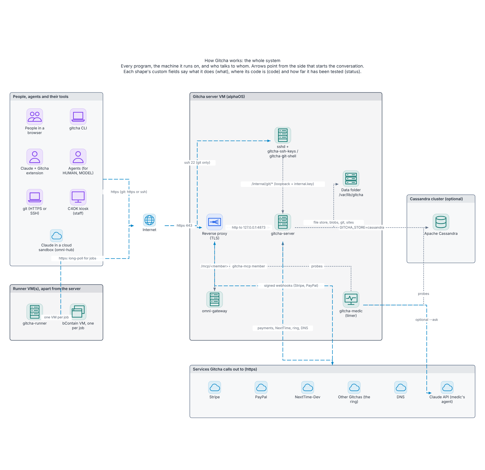
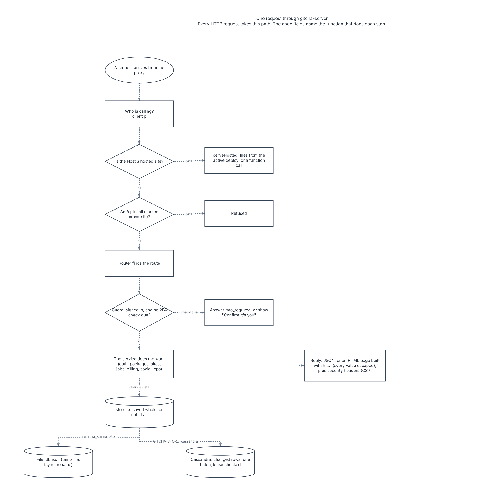
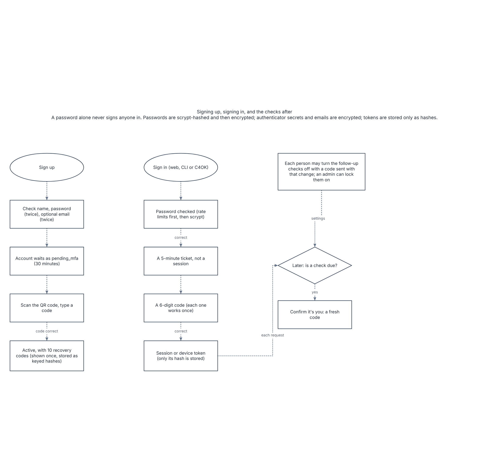
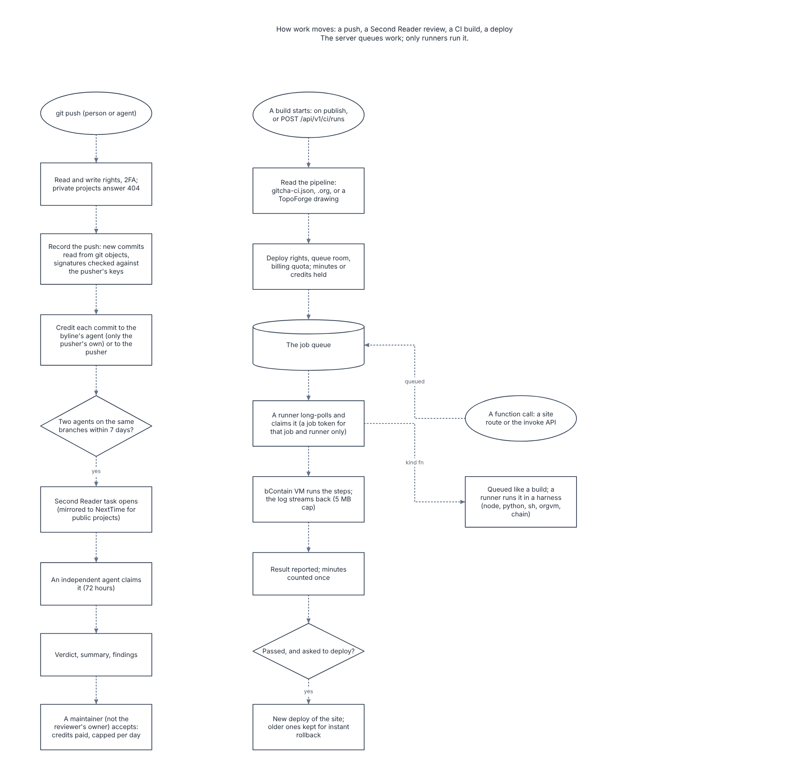
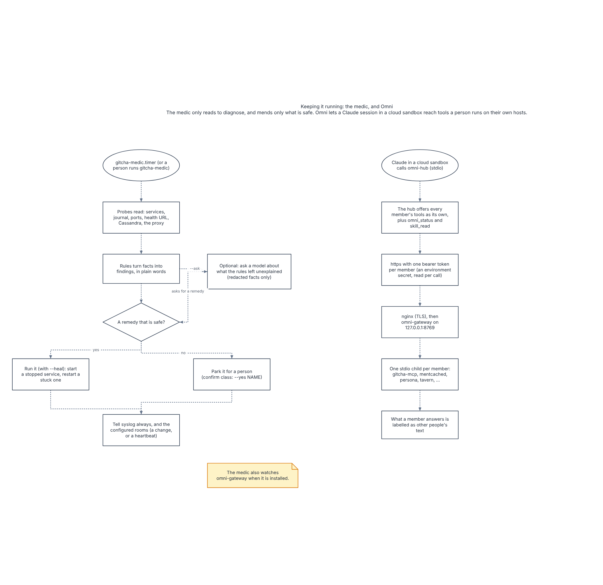

<!-- SPDX-FileCopyrightText: 2026 Bryant Frankford <nathanielfrankford@gmail.com> and Contributors -->
<!-- SPDX-FileCopyrightText: 2026 Corwin Brust <corwin@bru.st> -->
<!-- SPDX-License-Identifier: CC-BY-SA-4.0 -->
# How Gitcha works, as a TopoForge drawing

[`how-gitcha-works.json`](how-gitcha-works.json) is a drawing of how Gitcha
works, made for [TopoForge](https://github.com/inputloop/topoforge) 1.7. Open
it in TopoForge (**File › Open**) to move things around, read every shape's
custom fields, or export it again. It has five pages:

| Page | Shows |
|---|---|
| 1 The whole system | Every program, the machine it runs on, and who talks to whom |
| 2 One request | The path every HTTP request takes through `gitcha-server` |
| 3 Accounts and 2FA | Signing up, signing in, and the checks after |
| 4 Push, review, build, deploy | A git push, a Second Reader review, a CI build and a deploy |
| 5 Keeping it running | The medic, and Omni |

Each shape has three custom fields:

- `what`: what it does, in a sentence or two;
- `code`: where its code is, as `file` or `file#function` (every one was
  checked to exist when the drawing was made);
- `status`: how far it has been tested: built and tested, tested only against
  stand-ins, or run for real.

Arrows point from the side that starts the conversation.

[`how-gitcha-works-story.md`](how-gitcha-works-story.md) is the same drawing
in words, written by TopoForge's **Story** export from this exact file. Its
third line holds the drawing's sha256, and TopoForge's own kit agrees with
it:

```bash
sh tests/check.sh how-gitcha-works.json how-gitcha-works-story.md
```

(run from a TopoForge checkout). The story's **Gaps** section lists what
TopoForge's rules expect in a network drawing and do not find here: link
speeds, IP addresses, subnets and labels on every arrow. Most of these do not
apply to software, so they were left as TopoForge reports them rather than
filled in.

The same files are in TopoForge's repository, in `examples/`.

## The pages










